<h1 align="center">
  <picture>
    <source media="(prefers-color-scheme: dark)" srcset="docs/assets/hero-dark.png">
    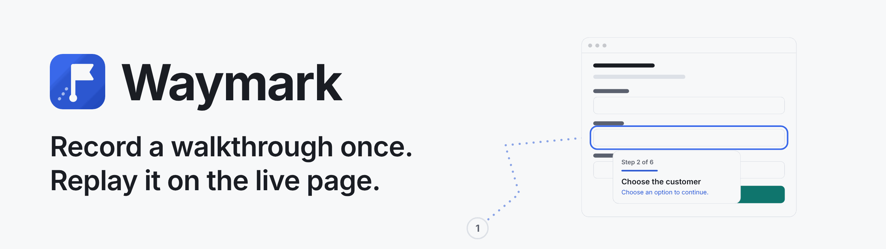
  </picture>
</h1>

Waymark is a Chromium (Manifest V3) extension that records click-by-click walkthroughs of a web app and replays them on the live page. It spotlights the real element, shows a note and can read it aloud. Guides hold no screenshots (an optional, off-by-default screenshot per step exists only for the printable how-to and stays on the device), there are no servers and no account, and it costs $0 to run.

<p align="center">
  <picture><source media="(prefers-color-scheme: dark)" srcset="docs/assets/poster-record-dark.png">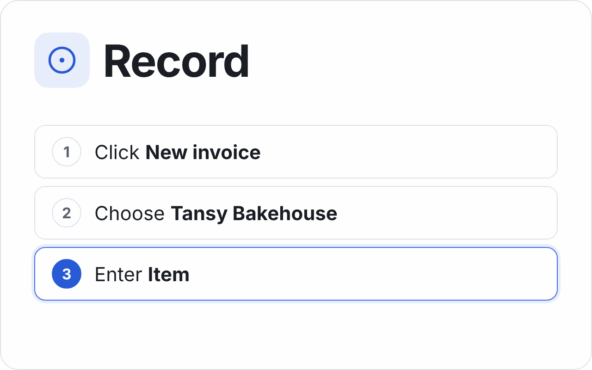</picture>
  <picture><source media="(prefers-color-scheme: dark)" srcset="docs/assets/poster-play-dark.png">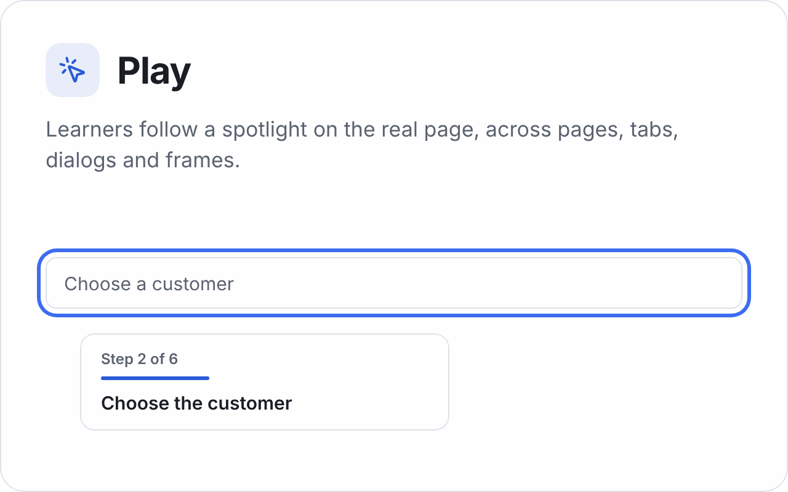</picture>
  <picture><source media="(prefers-color-scheme: dark)" srcset="docs/assets/poster-share-dark.png">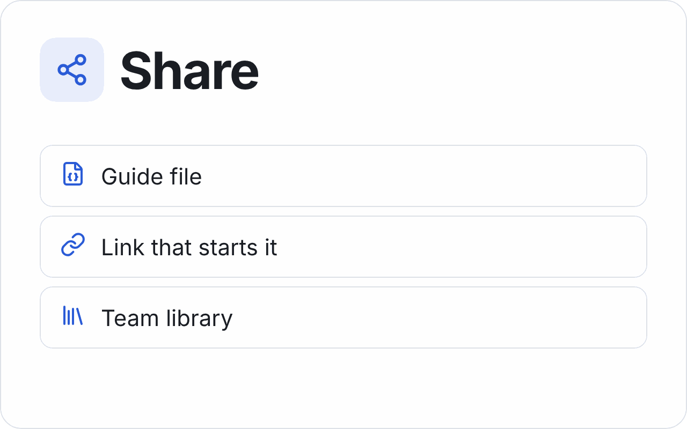</picture>
  <picture><source media="(prefers-color-scheme: dark)" srcset="docs/assets/poster-private-dark.png">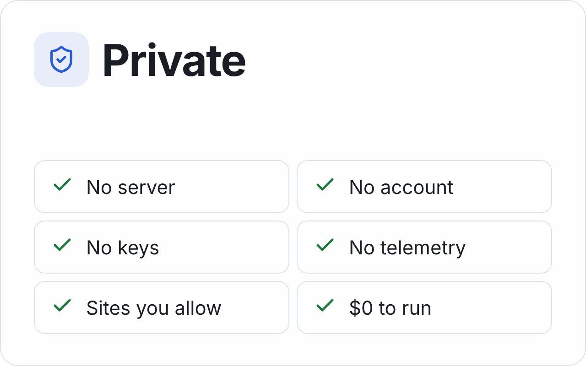</picture>
</p>

- **Record:** press Record and do the task. Waymark writes a step for each click, choice and field, and never stores what you type.
- **Play:** a learner follows the spotlight on the real page, across pages, tabs, dialogs and iframes. When a step can't be found, Waymark says so instead of pointing at the wrong element.
- **Share:** export a pack file, copy a link that starts a guide, or subscribe to a team library URL.
- **Private:** Waymark works only on sites you allow, one at a time. Guides stay in your browser, and there is no telemetry ([privacy policy](docs/PRIVACY.md)).

**Status:** v0.10.0. Milestones M0–M5 are done (scaffold, matcher, recorder, player, editor and voice, discovery and sharing). From M6 it has the popup fallback and an optional on-device HD voice. It is for internal use and installed from a release; a store listing draft is kept in [docs/STORE.md](docs/STORE.md) for later (D58). What changed in each version is in [CHANGELOG.md](CHANGELOG.md).

## See it work

Screenshots of the made-up "Demo Books" app in the test fixtures, re-shot each release with `pnpm shots:readme`.

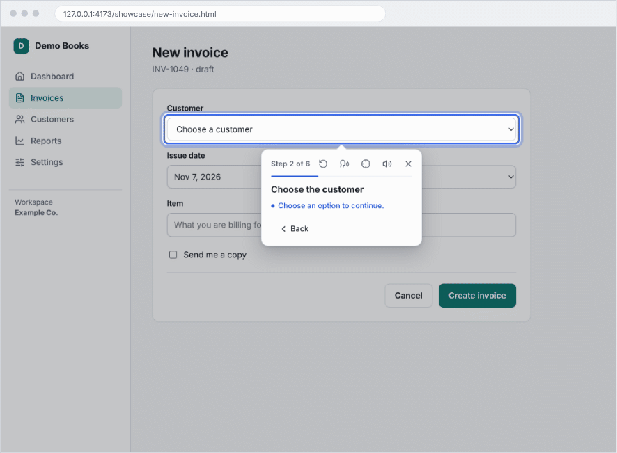

**Record.** While you record, an outline shows what a click will record, and the panel lists each step.

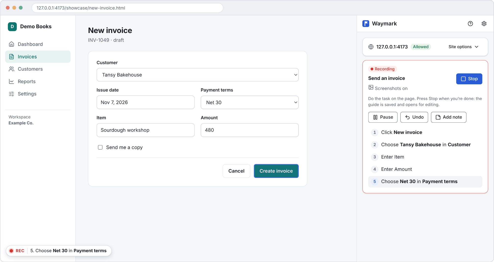

**Play.** The spotlight and the tooltip show the learner the next step on the live page.

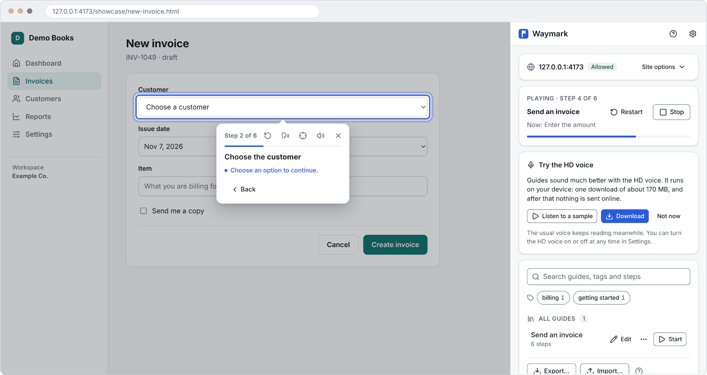

**Edit.** Change a step's text, add a note, test it on the page, point it at another element, or drag a step by its handle to reorder.

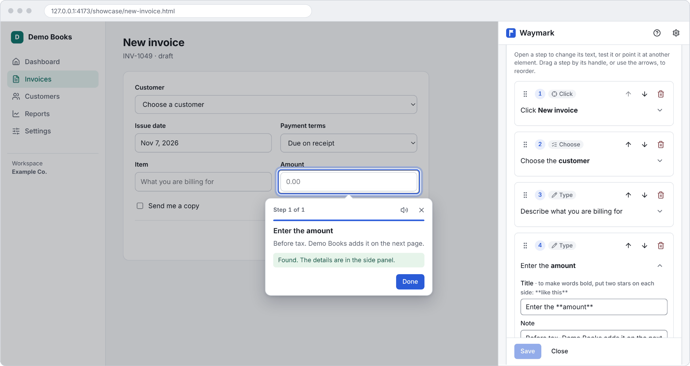

**Find.** The `?` button on the page lists the guides for that page, with a search once there are many.

<p align="center">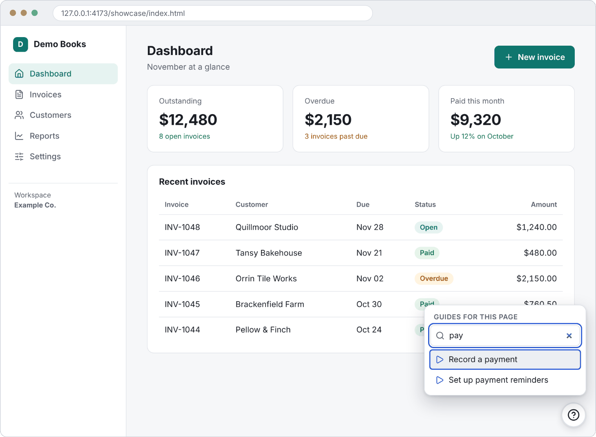</p>

**Print.** Export a printable how-to. With screenshots turned on while recording, steps get a picture with their element outlined; you can add a missing one from the editor.

<p align="center">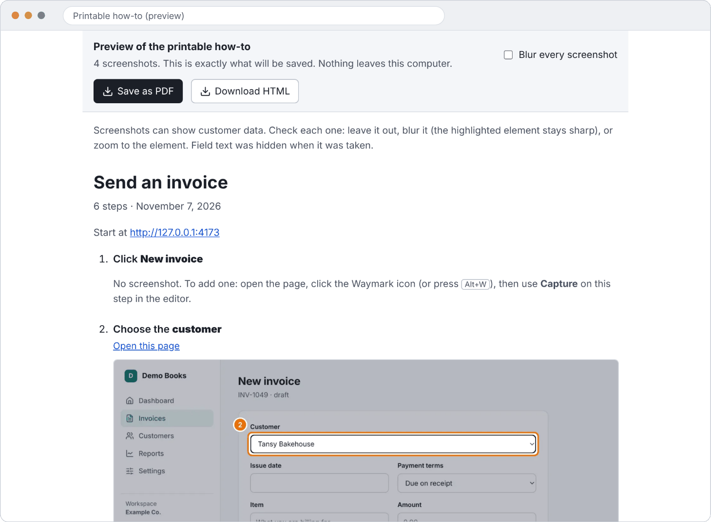</p>

## Install

Waymark is for internal use and isn't in a store, so install it in developer mode (D58). It works in Chrome and Edge (version 120 or later); other Chromium browsers are still being checked.

1. **Download the zip:**
   - **A release (recommended).** Open the repository's **Releases** page and download `waymark-X.Y.Z-chrome.zip` from the latest release. Each release has a `.sha256` file to check the download. While the repository is private, only people with access to it can see Releases and Actions.
   - **The latest `main` build.** Open **Actions → CI**, pick the newest green run on `main`, and download the `waymark-extension` artifact. Artifacts expire after 14 days.
2. Unzip it into a folder you'll keep: the browser loads the extension from that folder.
3. Open `chrome://extensions` (or `edge://extensions`) and turn on **Developer mode**.
4. Click **Load unpacked** and choose the unzipped folder.
5. To update, replace the folder's contents with a newer zip and click the reload icon on the extension's card.

Testers: [docs/TESTING.md](docs/TESTING.md) walks through everything worth trying.

## Quick start

1. Open a web app and click the Waymark toolbar icon. The side panel opens. Click **Allow on this site** to grant that site only.
2. Name a new guide and press **Record**, then do the task in the app. Each step appears in the panel and in the on-page REC pill. Press **Stop** to save the guide.
3. Click a step to edit its title or add a note. **Test step** shows what the player will spotlight, and **Re-pick element** fixes a wrong element.
4. Press **Start** next to a guide to play it. Do each highlighted action, or press **Next** on note steps, to move on. If you're not on the guide's first page, the panel offers **Open start page**.
   - Shortcuts: `Alt+.` next, `Alt+,` back (change them at `chrome://extensions/shortcuts`).
   - `Esc` in the tooltip exits.
5. To share, use **Export** (with a review of everything in the pack), **Import pack**, or **Copy link**. Under **Settings** (a button in the side panel) you'll find:
   - the voice per language, speed and auto-play;
   - the optional HD voice;
   - **Allow online voices**: off by default, because those voices send step text to the voice provider;
   - a team library URL.

## Development

Requires Node 22 and pnpm 10.

```sh
pnpm install
pnpm dev             # WXT dev mode with reload
pnpm build           # production build -> .output/chrome-mv3
pnpm build:test      # test build (test hooks on) -> .output-test/chrome-mv3-test
pnpm zip             # production zip -> .output/waymark-<version>-chrome.zip
pnpm demo            # demo app for manual testing at http://localhost:8080
```

To try your own build, load `.output/chrome-mv3` with **Load unpacked** (see Install).

Tests and checks:

```sh
pnpm check           # typecheck, lint, both builds, manifest guard, unit + browser tests: run before every push
pnpm test:unit       # Vitest + happy-dom: pure logic
pnpm test:browser    # Vitest browser mode in Chromium: matcher, robustness suite
pnpm test:e2e:xvfb   # Playwright with the built extension, headed under Xvfb
pnpm check:manifest  # no content_scripts, no host_permissions, no CDN code
pnpm bench           # performance harness (not part of check)
pnpm screens         # screenshots of every panel and on-page state, light and dark (D90)
pnpm shots:readme    # re-shoots the README graphics in docs/assets (D230; docs/BRAND.md)
pnpm test:real       # opt-in: record and replay tasks on public demo apps (network + Xvfb; docs/RELIABILITY.md)
pnpm fixture         # the fixture app at http://127.0.0.1:4173
```

The e2e tests that grant site access need a display, because Chrome's permission dialog is native UI (DECISIONS D10). Without one (`pnpm test:e2e`), they are skipped.

**CI** (`.github/workflows/ci.yml`) runs on pull requests, on pushes to `main` and by hand. It skips docs-only changes, and its single summary check is **CI result** (D54). It runs the e2e suite on every code change (D162), and every change runs it locally before it is pushed.

**Releases** (`.github/workflows/release.yml`):
1. `pnpm release X.Y.Z` bumps the version in `package.json`, `CHANGELOG.md`, `docs/STATUS.md` and this README.
2. Run `pnpm check`, open a PR and merge it to `main`.
3. In **Actions → Release → Run workflow** (on `main`), enter `X.Y.Z` and, best, the release PR's merge commit (full SHA). The workflow tags it `vX.Y.Z`; left empty, it tags `main`'s latest commit, which must have a CI run (D160). Pushing a tag `vX.Y.Z` on the merge commit yourself does the same.

The workflow then checks and builds the commit and publishes a GitHub Release with the zip and the changelog notes (D56).

## Layout

```
src/entrypoints/   background (service worker), sidepanel, options, offscreen, waymark-content (unlisted content script)
src/background/    service worker handlers: runs, recording, editor, discovery, voice, HD voice
src/offscreen/     the optional HD voice engine (offscreen document)
src/ui/            design tokens and shared components (D90)
src/content/       content script runtime: recorder, player overlay, route watching, frame mapping, lifecycle
src/core/          fingerprint, matcher, model (Zod), messaging, permissions, storage, sharing, voice, url, text
test/unit/         Vitest + happy-dom
test/browser/      Vitest browser mode: fingerprint, wait loop, robustness suite
test/e2e/          Playwright end-to-end with the built extension
test/fixtures/     the tricky fixture app and its static server
scripts/           manifest and CDN guards, CI and release helpers
```

## Docs

| Document | What's in it |
| --- | --- |
| [docs/SPEC.md](docs/SPEC.md) | The spec: the source of truth |
| [docs/DECISIONS.md](docs/DECISIONS.md) | Every deviation from the spec and why (D-numbers) |
| [docs/STATUS.md](docs/STATUS.md) | What works, where the tricky code lives, how to test: start here |
| [docs/TESTING.md](docs/TESTING.md) | Hands-on test script for testers |
| [docs/SECURITY.md](docs/SECURITY.md) | Threat model and audit |
| [docs/RELIABILITY.md](docs/RELIABILITY.md) | Real-site reliability results and known limits |
| [docs/PRIVACY.md](docs/PRIVACY.md) | Privacy policy |
| [docs/STORE.md](docs/STORE.md) | Chrome Web Store listing draft |
| [docs/BRAND.md](docs/BRAND.md) | Logo, colours, type and how to re-shoot the README graphics |
| [CHANGELOG.md](CHANGELOG.md) | Changes per version |
| [THIRD_PARTY_NOTICES.md](THIRD_PARTY_NOTICES.md) | Licenses of bundled code and the HD voice model |
